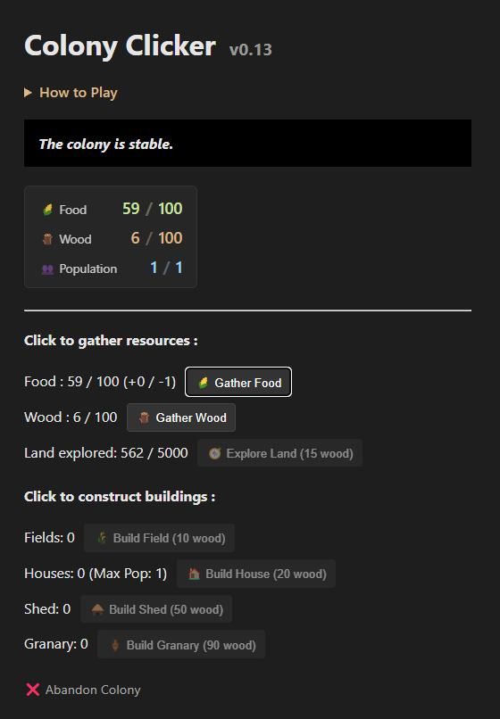
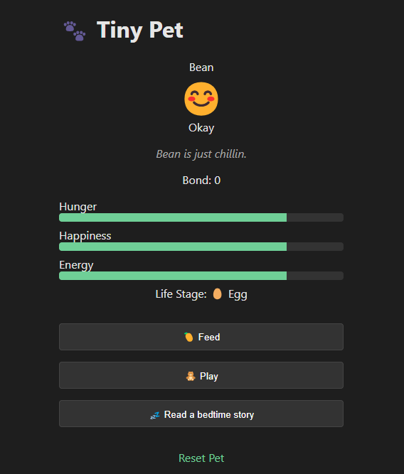

# Tiny Games

Tiny Games is a collection of small but fun, experimental web games.

These games are intentionally simple when first released, then added to and iterated over time as a creative outlet of mine.

**[Play the live site](https://jeanbeanie.github.io/tiny-games)**

### Philosophy
- Small scope, big ideas
- Minimalist, intentional design

## Games

### Colony Clicker
A minimalist idle game about managing a growing colony with limited resources.

- Status: In active development
- Focus: Balancing growth against scarce resources and random setbacks
- Current version: v0.13

### Tiny Pet
A lightweight virtual pet / idle game inspired by Tamagotchi-style care mechanics.

- Status: In active development
- Focus: Cozy, low pressure pet care
- Current version: v0.6.1

## Tech
- Plain HTML, CSS, and JavaScript
- No frameworks
- LocalStorage-based persistence
- Basic automated tests (Node's built in test runner)

## Notes
These games are works in progress and may change frequently. Feedback and curiosity are welcome!
